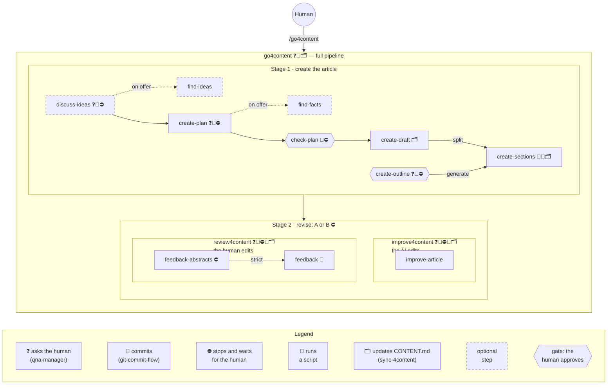

# Skills map

The orchestrators are frames; the skills they run sit inside. Services used by
almost every skill are badges on the cards instead of arrows (see the legend).

- **Stage 1** has two roads to the section files. In case 1B the sections are
  **split** from a draft written to a plan; the discussion of ideas is optional
  (the words `discuss` / `full` turn it on), and both web searches run only if the
  human accepts the offer of `discuss-ideas` or `create-plan`. In case 1A
  (braindump) and 1C with a rough draft the sections are **generated** from an
  outline the human approves at the gate; a final draft of 1C is split as is
  ([go4content process](2-go4content.md)).
- **Stage 2** is two orchestrators of their own: `go4content` hands the article to
  one of them, and the human can also start either one directly
  (`/improve4content`, `/review4content`).
- Every content skill can also be run directly by its prompt words
  ([matrix](README.md#where-each-skill-is-used)).
