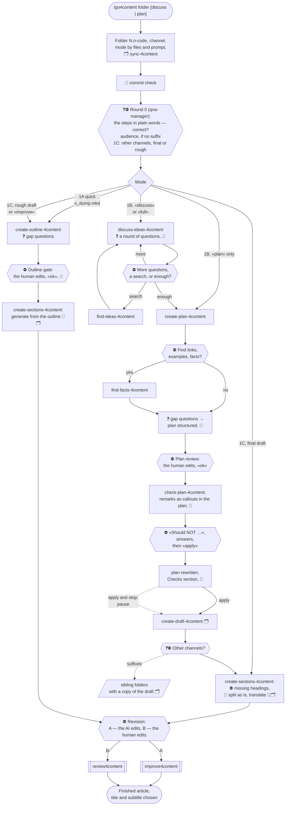

# go4content process

From a folder with a braindump or a draft to section files, then to one of the two
revision orchestrators. Hexagons are the places where the agent stops and waits for
the human.

In chat the agent never names a mode by its code: round 0 describes the steps in
plain words ("First we discuss the ideas of your notes, then I build a plan and write
the draft. Correct?").
