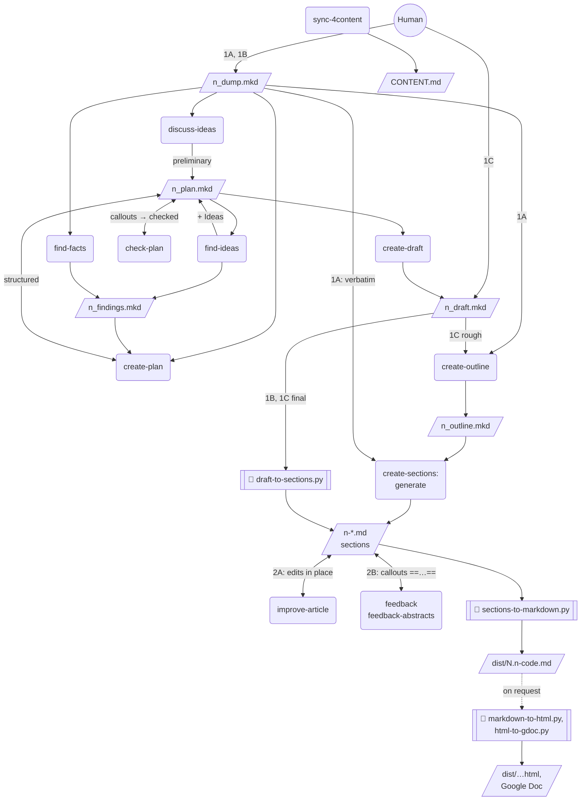

# Artifact flow

Files are parallelograms, skills are rounded boxes. `n_plan.mkd` is one file that
moves through statuses ([plan statuses](4-plan-statuses.md)); the edge labels show
the status after a step. An outline appears only where the sections are generated:
from a braindump (1A) or a rough draft (1C). A draft written to a plan (1B) and a
final human draft (1C) are split by a script as is.

Not drawn, to keep the picture readable:
- `n_qna.md`: `qna-manager` writes it for `go4content`, `discuss-ideas`,
  `create-plan`, `create-outline`, `improve4content`, and `review4content`; every
  skill reads its `## Audience` section.
- The calls to `sync-4content`: `go4content`, `create-draft`, `create-sections`,
  `improve4content`, and `review4content` run it; it derives the status of the
  piece's entry from the files in the folder.
