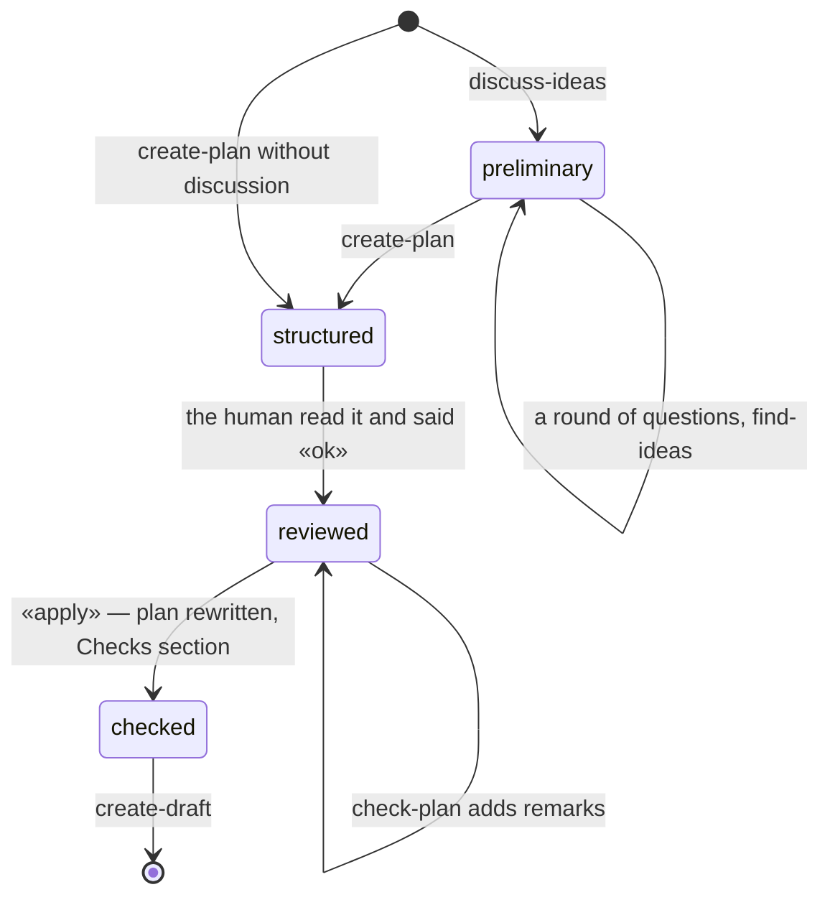

# Plan statuses

`n_plan.mkd` moves through the statuses of `rules/plan_rules.md`. The planning
skills do not know the mode; they act on the status: it tells them where to start and
what to offer the human.

Not drawn: `check-plan` also works on a `structured` plan if the human skips the
review, and `create-draft` on a `structured` or `reviewed` one if the human skips the
check. In both cases the skill first offers the skipped step.
