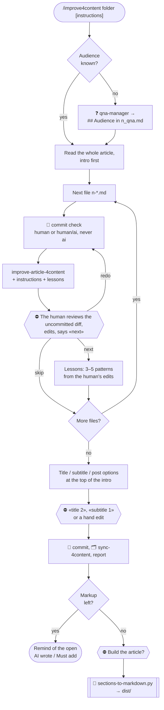

# improve4content process

The AI edits, the human reviews — one file at a time, so that the human's
corrections become lessons for the next file.

The commit comes **before** the AI's edit, not after: the human reviews the edit as
an uncommitted diff in the IDE.
