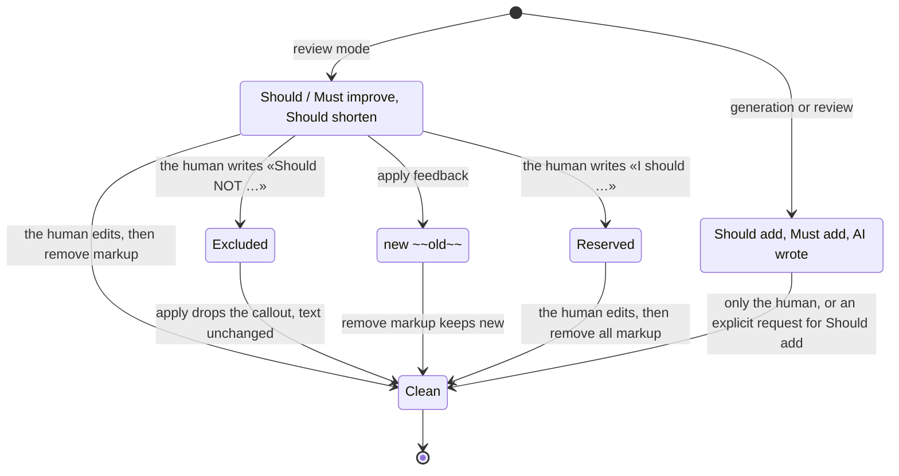

# Life of a callout

The markup protocol of `feedback-4content` (review and apply modes). The human
steers it by editing the callout label. `check-plan-4content` uses the same notation
for its remarks on a plan: `Should NOT …` drops a remark, `apply` rewrites the plan
and removes all callouts.

